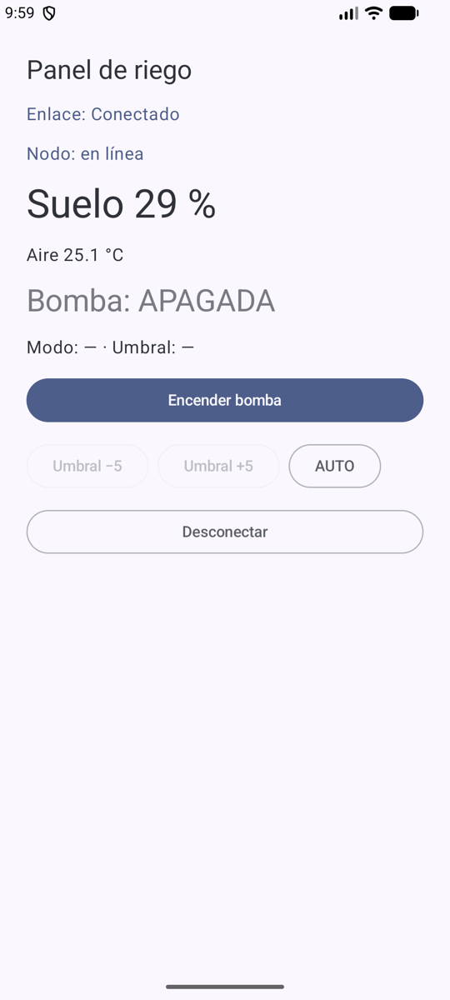
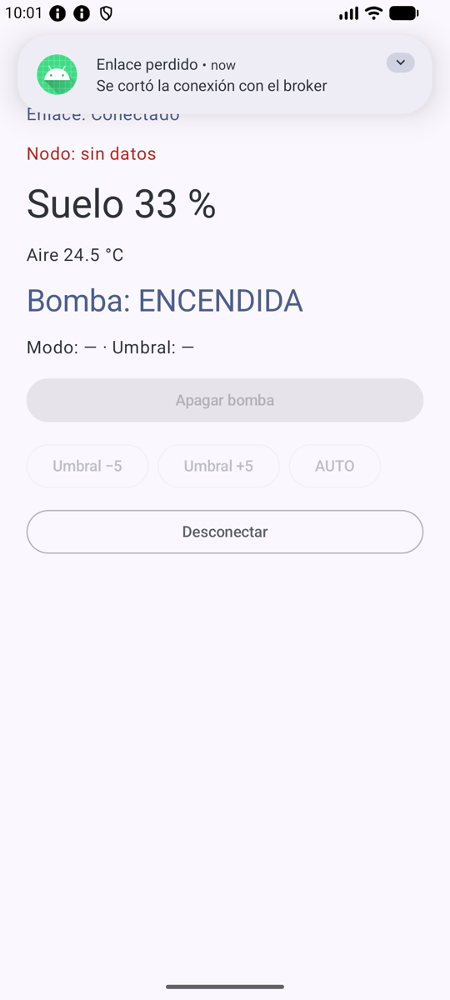
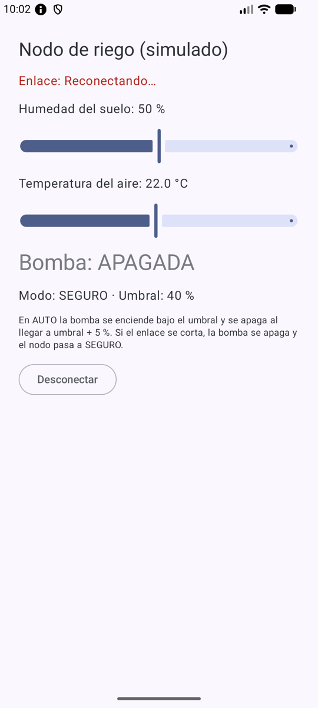
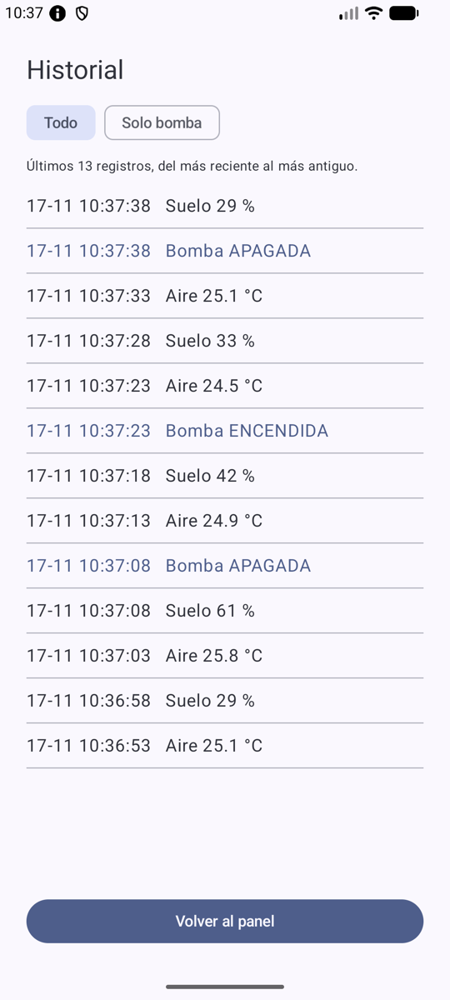
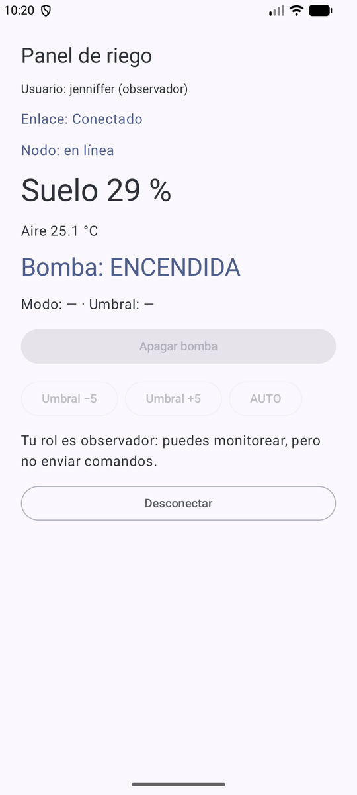
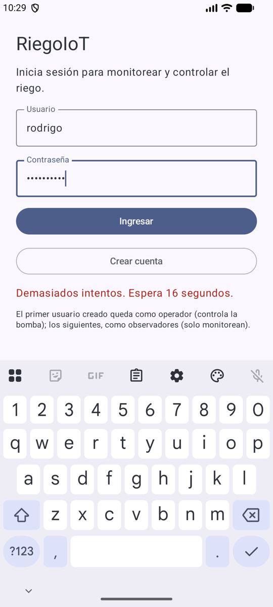
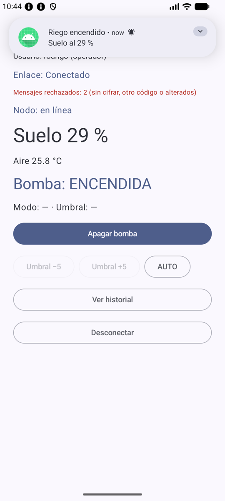

# RiegoIoT-App

App Android para monitorear y controlar el riego desde el teléfono. Es la Unidad 2 de **Aplicaciones Móviles para IoT (TI3042, INACAP)**.

**Estudiantes:** Jenniffer Gonzalez y Rodrigo Cutiño · Proyecto de la Unidad 1: [ProyectRiego](https://github.com/rodrigocutinoa/ProyectRiego)

Una sola app con dos roles. El **Nodo de riego** simula el sensor de humedad del suelo, el de temperatura y la bomba. El **Panel** muestra el estado en vivo y controla la bomba. Se comunican por **Wi-Fi con MQTT**, y el lado IoT (broker, canal Wi-Fi y fallas) se simula con [hertzbench](https://github.com/Rixmerz/hertzbench), conectado a Claude Code por MCP.

| Panel (operador) | Notificación de enlace | Nodo en modo seguro | Historial |
|:-:|:-:|:-:|:-:|
|  |  |  |  |

| Observador (sin control) | Bloqueo tras 5 fallos | Esperando confirmación | Mensajes sin cifrar rechazados |
|:-:|:-:|:-:|:-:|
|  |  |  |  |

## Qué hace

| ID | Funcionalidad | Estado |
|---|---|:-:|
| F1 | El nodo publica la humedad del suelo y la temperatura cada 5 s. En AUTO enciende la bomba bajo el umbral y la apaga al llegar a umbral + 5 % | ✔ |
| F2 | El panel muestra en vivo la humedad, la temperatura, la bomba, el modo, el umbral y si el nodo está en línea | ✔ |
| F3 | El panel enciende o apaga la bomba, cambia el umbral y vuelve a AUTO; el nodo confirma con `ACK`. Si no llega la confirmación en 5 s, reenvía hasta 3 veces y avisa | ✔ |
| F4 | **Notificación cada vez que el riego se enciende o se apaga**; también al perder el enlace y, en el nodo, al recibir un comando | ✔ |
| F5 | Si se corta el enlace, el nodo apaga la bomba y pasa a `SEGURO`. El estado se publica retenido, así el panel ve el estado real al reconectar | ✔ |
| F6 | Login con SQLite y PBKDF2; el primer usuario es **operador** y los siguientes, **observadores** (solo monitorean). Bloqueo de 30 s tras 5 fallos | ✔ |
| F7 | Historial de lecturas y de encendidos y apagados de la bomba | ✔ |
| Seguridad | Mensajes cifrados con AES-GCM y un código de vinculación de 6 dígitos (igual en el nodo y el panel). Se rechazan los mensajes sin cifrar, con otro código, alterados o movidos de tópico, y los comandos de más de 30 s | ✔ |

El diseño completo está en [docs/HITOS_1_2.md](docs/HITOS_1_2.md): problemática, herramientas, por qué se usa Wi-Fi con MQTT, mensajes, mockup y login.

## Cómo ejecutar contra hertzbench

### 1. Preparar el computador (macOS)

```bash
git clone https://github.com/rodrigocutinoa/ProyectRiego.git ~/Dev/Inacap/AppIoT/ProyectRiego
git clone https://github.com/rodrigocutinoa/RiegoIoT-App.git ~/Dev/Inacap/AppIoT/RiegoIoT-App
~/Dev/Inacap/AppIoT/ProyectRiego/hertzbench/preparar-mac.sh   # Deno, mosquitto, hertzbench y Android Studio
```

Después hay que abrir Android Studio una vez (asistente **Standard**) para que descargue el SDK y cree un emulador.

### 2. Levantar la simulación

Hay dos escenarios en `ProyectRiego/hertzbench/`. Los dos dejan el broker en el puerto 1883 del computador:

| Escenario | Para qué |
|---|---|
| `riego-mqtt.yaml` | Broker más un **nodo de riego simulado**. Sirve para probar la app como **Panel** con un solo emulador |
| `riego-broker.yaml` | Broker más un monitor suscrito a `riego/#`. Sirve para probar la app como **Nodo**, o con dos emuladores (Nodo y Panel) |

**Desde Claude Code (MCP):** abrir Claude Code en `ProyectRiego`, aprobar el servidor `hertzbench` y pedir, por ejemplo, *«corre hertzbench/riego-mqtt.yaml»*. Con el MCP también se publican comandos (`mqtt_publish`), se corta el enlace (`inject_fault`) y se lee el tráfico (`get_serial`).

**Desde la terminal:**

```bash
cd ~/Dev/Inacap/AppIoT/ProyectRiego
hertzbench run hertzbench/riego-mqtt.yaml --out /tmp/riego-out
# en otra terminal, para ver el tráfico:
mosquitto_sub -h 127.0.0.1 -p 1883 -t 'riego/#' -v
```

### 3. Correr la app

1. Abrir `RiegoIoT-App` en Android Studio y presionar **Run ▶** con el emulador elegido.
2. Aceptar los permisos de **notificaciones** y de **dispositivos cercanos / red local**.
3. **Crear cuenta.** La primera queda como operador.
4. Elegir el rol **Panel** o **Nodo de riego**, con el broker `10.0.2.2`, el puerto `1883` y el **código de vinculación `123456`**, y presionar **Conectar**. Desde el emulador, `10.0.2.2` es el computador. El nodo simulado de `riego-mqtt.yaml` usa ese código.

Desde la terminal: `JAVA_HOME="/Applications/Android Studio.app/Contents/jbr/Contents/Home" ./gradlew installDebug`.

> **Android 17 (API 37):** la app necesita el permiso `ACCESS_LOCAL_NETWORK` para conectarse a `10.0.2.2`. Sin él, la conexión expira aunque el puente funcione. La app lo pide al abrirse.
> **Teléfono físico:** hay que cambiar `listen: 127.0.0.1` por `listen: 0.0.0.0` en el escenario y conectar la app a la IP del computador en la misma red Wi-Fi.

## Mensajes

Cada mensaje es una línea `TIPO;clave;valor`. Todo lo que no calce con el formato o con los rangos permitidos se descarta.

**En el aire viaja cifrado:** `Base64(iv + AES-GCM("<hora en ms>|TIPO;clave;valor"))`. La clave AES-256 sale del código de vinculación con PBKDF2, y el tópico va como dato autenticado. Para publicar un mensaje cifrado desde hertzbench (`mqtt_publish`) se usa `deno run ProyectRiego/hertzbench/cifrar.ts 123456 riego/cmd "CMD;bomba;ON"`.

**Límite declarado:** el código de 6 dígitos con sal fija sirve para la demostración, pero no para producción, donde se usaría ECDH o el Android Keystore. La ventana de 30 s reduce la repetición de comandos, pero no la elimina.

| Tópico | Ejemplo | Dirección |
|---|---|---|
| `riego/lectura` | `LECTURA;suelo;42` · `LECTURA;temp;24.5` | Nodo → Panel |
| `riego/estado/<clave>` (retenido) | `ESTADO;bomba;ON` · `ESTADO;modo;SEGURO` · `ESTADO;umbral;35` | Nodo → Panel |
| `riego/cmd` | `CMD;bomba;OFF` · `CMD;umbral;40` · `CMD;modo;AUTO` | Panel → Nodo |
| `riego/ack` | `ACK;bomba;OFF` | Nodo → Panel |

## Pruebas

```bash
JAVA_HOME="/Applications/Android Studio.app/Contents/jbr/Contents/Home" ./gradlew testDebugUnitTest
```

Las 13 pruebas unitarias cubren el formato y los rangos de los mensajes, los tópicos, PBKDF2, el bloqueo del login y el cifrado AES-GCM: ida y vuelta, otro código, otro tópico, mensaje alterado, texto sin cifrar y compatibilidad con `cifrar.ts`. Las pruebas en el emulador contra hertzbench, con los comandos y los cortes de enlace hechos por MCP, están en la bitácora de [ProyectRiego/docs/EVA2_AVANCE.md](https://github.com/rodrigocutinoa/ProyectRiego/blob/main/docs/EVA2_AVANCE.md).

## Estado

| Hito | Estado |
|---|---|
| 0 | Proyecto Android (minSdk 26, Kotlin DSL) corriendo en el emulador |
| 1 y 2 | Definición y diseño: [docs/HITOS_1_2.md](docs/HITOS_1_2.md) |
| 3 | Conexión MQTT, roles Nodo y Panel, comandos y notificaciones |
| 5 | Login con SQLite, PBKDF2 y roles |
| 6 | Historial en SQLite |
| 4 | Cifrado AES-GCM de los mensajes con código de vinculación |
| 7 | Por consultar con el profesor: medidas ISO/IEC 27400 y OT, y tabla de pruebas P1–P14 |
| 8 | Pendiente: demostración |

## Herramientas

Android Studio · Kotlin · Jetpack Compose y Material 3 · corrutinas · Eclipse Paho MQTT 1.2.5 · SQLite · `javax.crypto` (PBKDF2 y AES-GCM) · hertzbench (MCP) · emulador Android 17 arm64.
