# RiegoIoT-App

App Android para monitorear y controlar el riego desde el teléfono. Es la Unidad 2 de **Aplicaciones Móviles para IoT (TI3042, INACAP)**.

**Estudiantes:** Jenniffer Gonzalez y Rodrigo Cutiño · Proyecto de la Unidad 1: [ProyectRiego](https://github.com/rodrigocutinoa/ProyectRiego)

Una sola app con dos roles. El **Nodo de riego** simula el sensor de humedad del suelo, el de temperatura y la bomba. El **Panel** muestra el estado en vivo y controla la bomba. Se comunican por **Wi-Fi con MQTT**, y el lado IoT (broker, canal Wi-Fi y fallas) se simula con [hertzbench](https://github.com/Rixmerz/hertzbench), conectado a Claude Code por MCP.

| Panel (operador) | Notificación de enlace | Nodo en modo seguro | Historial |
|:-:|:-:|:-:|:-:|
|  |  |  |  |

| Observador (sin control) | Bloqueo tras 5 fallos | Esperando confirmación | Mensajes sin cifrar rechazados |
|:-:|:-:|:-:|:-:|
|  |  | 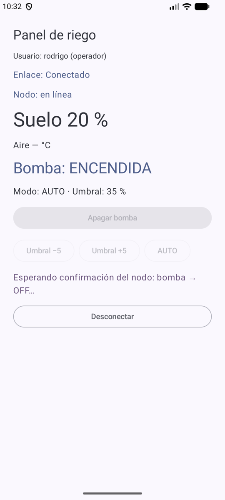 |  |

## Qué hace

| ID | Funcionalidad | Estado |
|---|---|:-:|
| F1 | El nodo publica la humedad del suelo y la temperatura cada 5 s. En AUTO enciende la bomba bajo el umbral y la apaga al llegar a umbral + 5 % | ✔ |
| F2 | El panel muestra en vivo la humedad, la temperatura, la bomba, el modo, el umbral y si el nodo está en línea | ✔ |
| F3 | El panel enciende o apaga la bomba, cambia el umbral y vuelve a AUTO; el nodo confirma con `ACK`. Si no llega la confirmación en 5 s, reenvía hasta 3 veces y avisa | ✔ |
| F4 | **Notificación cada vez que el riego se enciende o se apaga**; también al perder el enlace y, en el nodo, al recibir un comando | ✔ |
| F5 | Si se corta el enlace, el nodo apaga la bomba y pasa a `SEGURO`. El estado se publica retenido, así el panel ve el estado real al reconectar | ✔ |
| F6 | Login con SQLite y PBKDF2; el primer usuario es **operador** y los siguientes, **observadores** (solo monitorean). Bloqueo de 30 s tras 5 fallos | ✔ |
| F7 | Historial de lecturas y de encendidos y apagados de la bomba | ✔ |
| Seguridad | Mensajes cifrados con AES-GCM y un código de vinculación de 6 dígitos (igual en el nodo y el panel). Se rechazan los mensajes sin cifrar, con otro código, alterados o movidos de tópico, y los comandos de más de 30 s | ✔ |

El diseño completo está en [docs/HITOS_1_2.md](docs/HITOS_1_2.md): problemática, herramientas, por qué se usa Wi-Fi con MQTT, mensajes, mockup y login.

## Cómo ejecutar contra hertzbench

### 1. Preparar el computador (macOS)

```bash
git clone https://github.com/rodrigocutinoa/ProyectRiego.git ~/Dev/Inacap/AppIoT/ProyectRiego
git clone https://github.com/rodrigocutinoa/RiegoIoT-App.git ~/Dev/Inacap/AppIoT/RiegoIoT-App
~/Dev/Inacap/AppIoT/ProyectRiego/hertzbench/preparar-mac.sh   # Deno, mosquitto, hertzbench y Android Studio
```

Después hay que abrir Android Studio una vez (asistente **Standard**) para que descargue el SDK y cree un emulador.

### 2. Levantar la simulación

Hay dos escenarios en `ProyectRiego/hertzbench/`. Los dos dejan el broker en el puerto 1883 del computador:

| Escenario | Para qué |
|---|---|
| `riego-mqtt.yaml` | Broker más un **nodo de riego simulado**. Sirve para probar la app como **Panel** con un solo emulador |
| `riego-broker.yaml` | Broker más un monitor suscrito a `riego/#`. Sirve para probar la app como **Nodo**, o con dos emuladores (Nodo y Panel) |

**Desde Claude Code (MCP):** abrir Claude Code en `ProyectRiego`, aprobar el servidor `hertzbench` y pedir, por ejemplo, *«corre hertzbench/riego-mqtt.yaml»*. Con el MCP también se publican comandos (`mqtt_publish`), se corta el enlace (`inject_fault`) y se lee el tráfico (`get_serial`).

**Desde la terminal:**

```bash
cd ~/Dev/Inacap/AppIoT/ProyectRiego
hertzbench run hertzbench/riego-mqtt.yaml --out /tmp/riego-out
# en otra terminal, para ver el tráfico:
mosquitto_sub -h 127.0.0.1 -p 1883 -t 'riego/#' -v
```

### 3. Correr la app

1. Abrir `RiegoIoT-App` en Android Studio y presionar **Run ▶** con el emulador elegido.
2. Aceptar los permisos de **notificaciones** y de **dispositivos cercanos / red local**.
3. **Crear cuenta.** La primera queda como operador.
4. Elegir el rol **Panel** o **Nodo de riego**, con el broker `10.0.2.2`, el puerto `1883` y el **código de vinculación `123456`**, y presionar **Conectar**. Desde el emulador, `10.0.2.2` es el computador. El nodo simulado de `riego-mqtt.yaml` usa ese código.

Desde la terminal: `JAVA_HOME="/Applications/Android Studio.app/Contents/jbr/Contents/Home" ./gradlew installDebug`.

> **Android 17 (API 37):** la app necesita el permiso `ACCESS_LOCAL_NETWORK` para conectarse a `10.0.2.2`. Sin él, la conexión expira aunque el puente funcione. La app lo pide al abrirse.
> **Teléfono físico:** hay que cambiar `listen: 127.0.0.1` por `listen: 0.0.0.0` en el escenario y conectar la app a la IP del computador en la misma red Wi-Fi.

## Mensajes

Cada mensaje es una línea `TIPO;clave;valor`. Todo lo que no calce con el formato o con los rangos permitidos se descarta.

**En el aire viaja cifrado:** `Base64(iv + AES-GCM("<hora en ms>|TIPO;clave;valor"))`. La clave AES-256 sale del código de vinculación con PBKDF2, y el tópico va como dato autenticado. Para publicar un mensaje cifrado desde hertzbench (`mqtt_publish`) se usa `deno run ProyectRiego/hertzbench/cifrar.ts 123456 riego/cmd "CMD;bomba;ON"`.

**Límite declarado:** el código de 6 dígitos con sal fija sirve para la demostración, pero no para producción, donde se usaría ECDH o el Android Keystore. La ventana de 30 s reduce la repetición de comandos, pero no la elimina.

| Tópico | Ejemplo | Dirección |
|---|---|---|
| `riego/lectura` | `LECTURA;suelo;42` · `LECTURA;temp;24.5` | Nodo → Panel |
| `riego/estado/<clave>` (retenido) | `ESTADO;bomba;ON` · `ESTADO;modo;SEGURO` · `ESTADO;umbral;35` | Nodo → Panel |
| `riego/cmd` | `CMD;bomba;OFF` · `CMD;umbral;40` · `CMD;modo;AUTO` | Panel → Nodo |
| `riego/ack` | `ACK;bomba;OFF` | Nodo → Panel |

## Seguridad: ISO/IEC 27400 y lineamientos OT (Hito 7)

La ISO/IEC 27400:2022 da lineamientos de seguridad y privacidad para soluciones IoT: identificar y autenticar, controlar el acceso, proteger los datos guardados y en tránsito, y resistir las fallas. En la industria OT, la familia IEC 62443 agrega el mínimo privilegio y que un equipo quede en un estado seguro cuando algo falla.

| Medida | Qué hace | Dónde | Punto que cumple |
|---|---|---|---|
| PBKDF2-SHA256 con sal de 16 bytes y 120 000 iteraciones | La contraseña nunca se guarda, solo la sal y el hash; adivinarla es lento | [`Cripto.hash`](app/src/main/java/cl/inacap/riegoiot/seguridad/Cripto.kt), [`BaseDatos`](app/src/main/java/cl/inacap/riegoiot/datos/BaseDatos.kt) | Cifrado de credenciales |
| Comparación en tiempo constante | `MessageDigest.isEqual` no revela cuántos bytes coinciden | [`Cripto.verificar`](app/src/main/java/cl/inacap/riegoiot/seguridad/Cripto.kt) | Cifrado de credenciales |
| Contraseña de al menos 8 caracteres | Rechaza contraseñas cortas al registrarse | [`PantallaLogin`](app/src/main/java/cl/inacap/riegoiot/ui/PantallaLogin.kt) | Autenticación |
| Bloqueo de 30 s tras 5 intentos fallidos | Frena los ataques de fuerza bruta | [`Bloqueo`](app/src/main/java/cl/inacap/riegoiot/seguridad/Bloqueo.kt), [`PantallaLogin`](app/src/main/java/cl/inacap/riegoiot/ui/PantallaLogin.kt) | Control de acceso |
| Roles operador y observador | Solo el operador envía comandos (mínimo privilegio) | [`BaseDatos`](app/src/main/java/cl/inacap/riegoiot/datos/BaseDatos.kt), [`PantallaPanel`](app/src/main/java/cl/inacap/riegoiot/ui/PantallaPanel.kt) | Control de acceso · OT (IEC 62443) |
| AES-256-GCM en cada mensaje, con el tópico como dato autenticado | Sin el código de vinculación nadie lee ni altera lo que viaja, ni mueve un mensaje a otro tópico | [`Cripto.cifrar`](app/src/main/java/cl/inacap/riegoiot/seguridad/Cripto.kt), [`MqttEnlace`](app/src/main/java/cl/inacap/riegoiot/enlace/MqttEnlace.kt) | Cifrado de datos sensibles · conexión segura |
| Comandos con hora, rechazados después de 30 s | Un comando grabado no sirve para repetirlo más tarde | [`MqttEnlace.abrir`](app/src/main/java/cl/inacap/riegoiot/enlace/MqttEnlace.kt) | Conexión segura |
| El nodo también valida al emisor | El nodo solo acepta comandos cifrados con su código, así que no basta con llegar al broker | [`MqttEnlace.abrir`](app/src/main/java/cl/inacap/riegoiot/enlace/MqttEnlace.kt) | Autenticación |
| Validación de mensajes | Se descarta lo que no sea `LECTURA`, `ESTADO`, `CMD` o `ACK` con una clave y un rango permitidos | [`Mensaje.desdeLinea`](app/src/main/java/cl/inacap/riegoiot/enlace/Mensaje.kt) | Protección de datos |
| Consultas con parámetros (`?`) | Evita la inyección SQL | [`BaseDatos`](app/src/main/java/cl/inacap/riegoiot/datos/BaseDatos.kt) | Protección de datos |
| `allowBackup="false"` | La base de datos no sale del teléfono en los respaldos | [Manifiesto](app/src/main/AndroidManifest.xml) | Protección de datos |
| `usesCleartextTraffic="false"` | Android bloquea HTTP sin TLS | [Manifiesto](app/src/main/AndroidManifest.xml) | Conexión segura |
| Permisos mínimos, en tiempo de ejecución | Solo Internet, red local y notificaciones; sin ubicación ni escaneo. Si se niegan, la app sigue funcionando | [Manifiesto](app/src/main/AndroidManifest.xml), [`MainActivity`](app/src/main/java/cl/inacap/riegoiot/MainActivity.kt) | Permisos adecuados |
| Estado seguro ante la pérdida del enlace | El nodo apaga la bomba, pasa a `SEGURO` y avisa en los dos lados | [`Sesion`](app/src/main/java/cl/inacap/riegoiot/Sesion.kt) | Lineamiento OT (IEC 62443) |
| Confirmación con reenvío y estado retenido | Un comando sin `ACK` se reenvía hasta 3 veces y después se avisa; el panel siempre ve el estado real | [`Sesion`](app/src/main/java/cl/inacap/riegoiot/Sesion.kt) | Lineamiento OT (resiliencia) |

**Límites declarados:**
- Un código de 6 dígitos con sal fija sirve para la demostración, pero no para producción. Ahí se usaría un intercambio de claves (ECDH) o claves guardadas en el Android Keystore.
- La conexión con el broker es MQTT sin TLS (puerto 1883). El contenido va cifrado con AES-GCM, pero los tópicos y los metadatos se ven. En producción se usaría MQTT sobre TLS (8883) con usuario y contraseña en el broker.
- La ventana de 30 s reduce la repetición de comandos, pero no la elimina. Un contador por mensaje la cerraría del todo.

## Pruebas

### Pruebas de funcionamiento P1–P14 (Hitos 4 y 7)

Se hicieron el 2026-11-18 en el emulador (Android 17, arm64), contra hertzbench controlado desde Claude Code por MCP. La guía usa dos teléfonos con Bluetooth y un ventilador; aquí el medio es Wi-Fi con MQTT y el actuador es la bomba. El lado que no corre en el emulador lo hace el nodo simulado (`riego-mqtt.yaml`) o se publica desde el MCP con `mqtt_publish`, con mensajes cifrados generados por `ProyectRiego/hertzbench/cifrar.ts`.

**Resultado: 14 de 14 pasan.**

| ID | Caso | Pasos (adaptados a MQTT y a la bomba) | Esperado | Resultado (2026-11-18) | Captura |
|---|---|---|---|---|:-:|
| P1 | Conexión | Panel con el código `123456`, contra el nodo simulado de `riego-mqtt.yaml` | «Conectado» y el nodo en línea | ✔ «Enlace: Conectado» y «Nodo: en línea» | [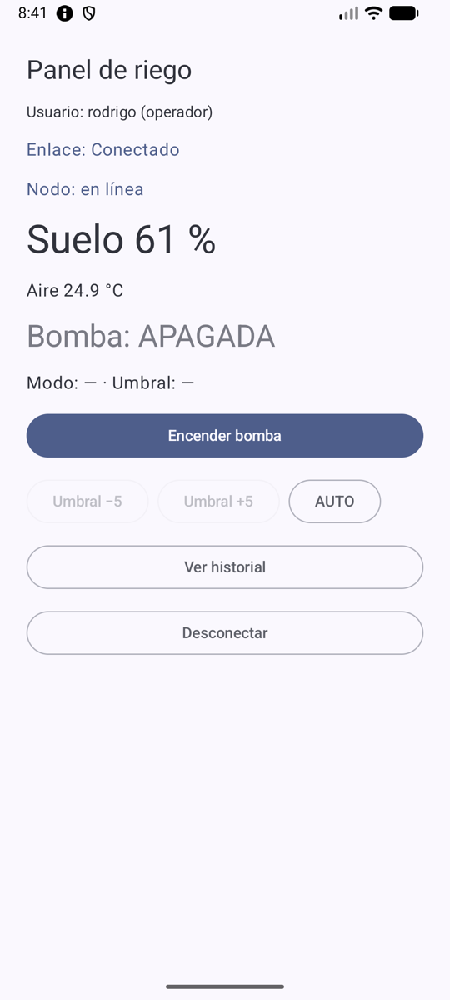](docs/capturas/p01-conexion.png) |
| P2 | Monitoreo | Publicar una lectura cifrada `LECTURA;suelo;25` desde el MCP (equivale a mover el sensor a 25) | El panel la muestra en 2 s o menos | ✔ «Suelo 25 %» en menos de 2 s | [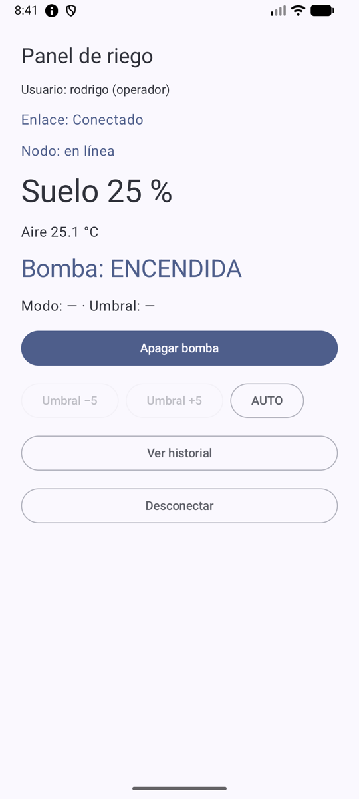](docs/capturas/p02-monitoreo.png) |
| P3 | Alerta | El nodo enciende o apaga la bomba; después llegan tres `ESTADO;bomba;ON` seguidos | Una notificación por cambio, sin repetir | ✔ «Riego apagado · Suelo al 61 %»; tres ON seguidos generan una sola notificación | [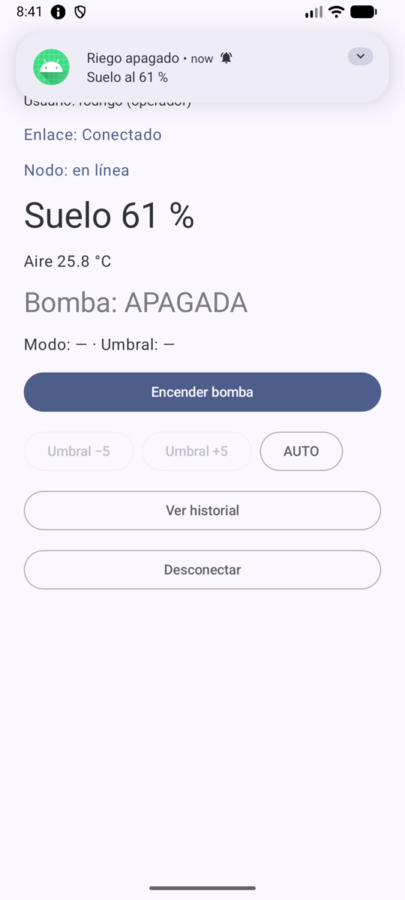](docs/capturas/p03-alerta.png) |
| P4 | Control | Nodo de la app recibe `CMD;bomba;ON` cifrado (enviado por MCP, en el papel del panel) | El nodo muestra ENCENDIDA, recibe una notificación y confirma | ✔ «Bomba: ENCENDIDA» (MANUAL), «Comando recibido · bomba → ON» y `ACK` cifrado a los 0,45 s. La confirmación en el panel: [captura del punto 4](docs/capturas/punto4-esperando-ack.png) | [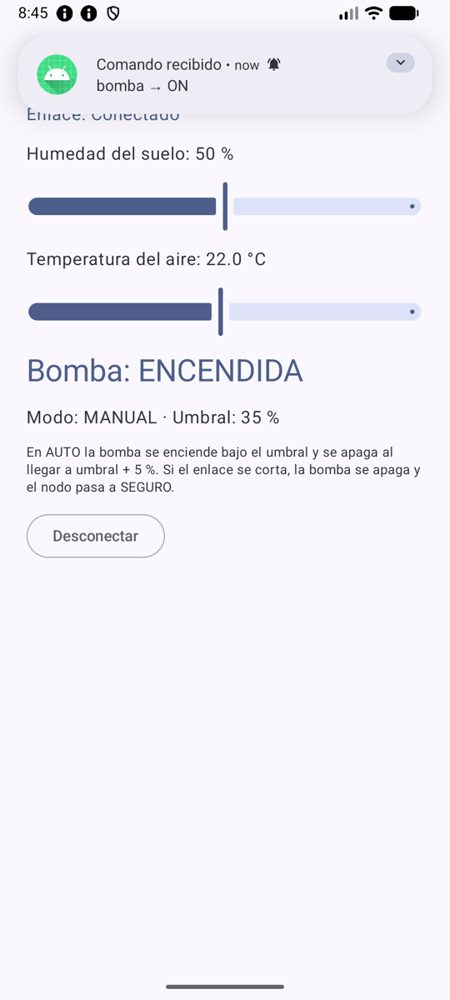](docs/capturas/p04-control.png) |
| P5 | Código distinto | Panel con `111111` y nodo simulado con `123456` | Se conectan, pero no pasa ningún dato | ✔ Conectado, «Mensajes rechazados: 9», «Nodo: sin datos» y botones deshabilitados | [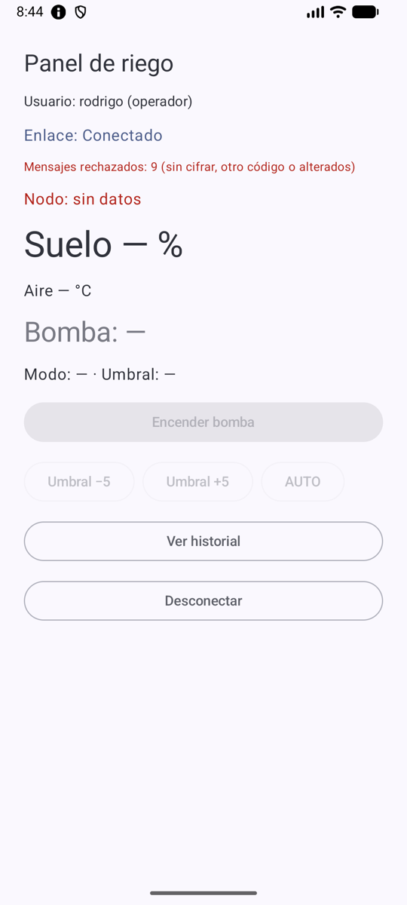](docs/capturas/p05-codigo-distinto.png) |
| P6 | Pérdida de enlace | Nodo con la bomba encendida; `inject_fault` con 100 % de pérdida | Aviso «Enlace perdido»; la bomba queda APAGADA | ✔ «Reconectando…», «Bomba: APAGADA», modo SEGURO y aviso «Enlace perdido · Bomba apagada por seguridad» | [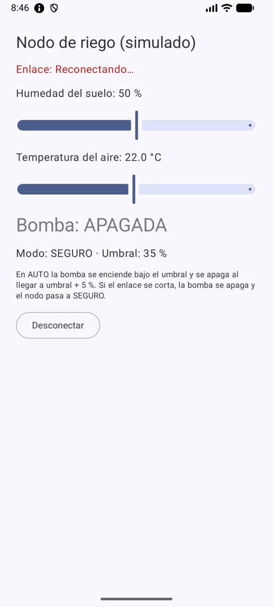](docs/capturas/p06-perdida-enlace.png) |
| P7 | Permiso negado | Negar el permiso de red local (`ACCESS_LOCAL_NETWORK`) e intentar conectar | Mensaje claro; la app no se cierra | ✔ «Falta el permiso de dispositivos cercanos / red local (Ajustes → Apps → RiegoIoT → Permisos)»; la app sigue abierta | [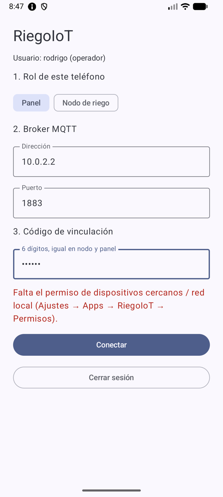](docs/capturas/p07-permiso-negado.png) |
| P8 | Registro y roles | Crear `rodrigo` y luego `jenniffer` | El primero operador, el segundo observador | ✔ «rodrigo (operador)» y «jenniffer (observador)» | [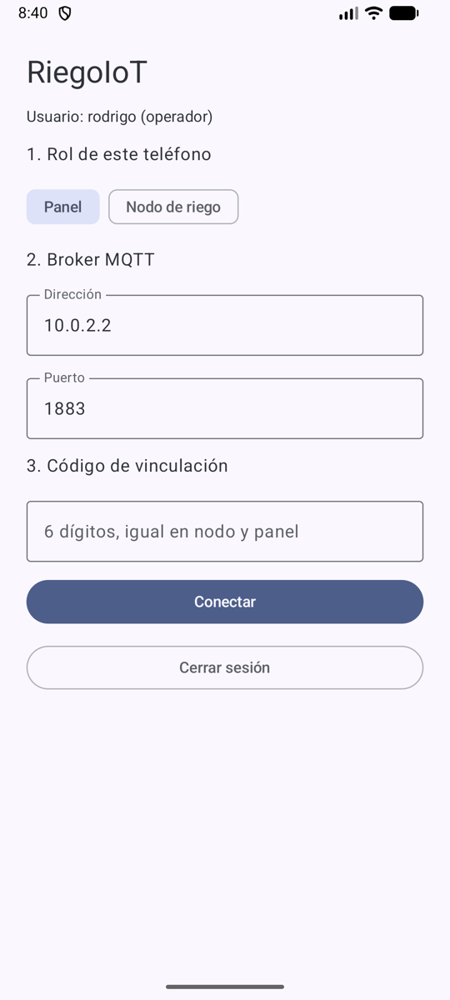](docs/capturas/p08a-operador.png) |
| P9 | Login incorrecto | Contraseña equivocada 5 veces y un sexto intento | Mensaje de error; bloqueo de 30 s | ✔ «Usuario o contraseña incorrectos» y luego «Demasiados intentos. Espera 11 segundos», sin verificar la contraseña | [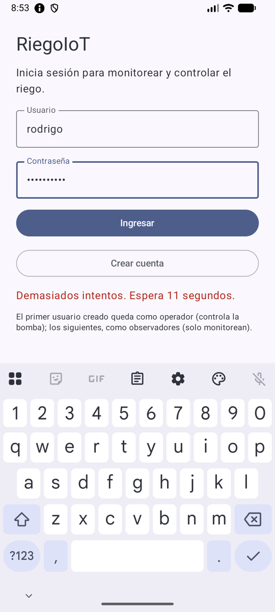](docs/capturas/p09b-bloqueo.png) |
| P10 | Contraseña corta | Registrar con 5 caracteres | Se rechaza (mínimo 8) | ✔ «La contraseña debe tener al menos 8 caracteres» | [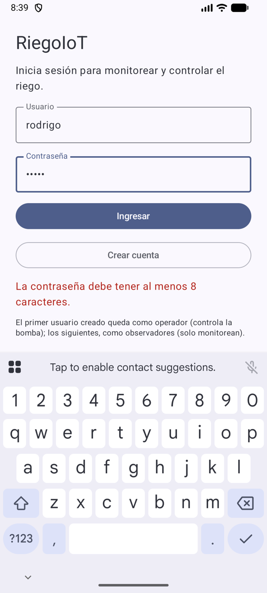](docs/capturas/p10-contrasena-corta.png) |
| P11 | Control de acceso | Entrar como observadora y abrir el panel | Ve los datos; el control está deshabilitado | ✔ Ve suelo, aire y bomba; botones deshabilitados y «Tu rol es observador…» | [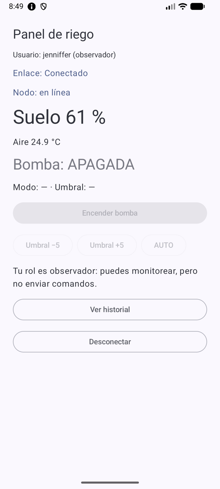](docs/capturas/p11-control-acceso.png) |
| P12 | Almacenamiento | Conectar 1 minuto y abrir el historial | Lecturas con su hora | ✔ 21 registros en 55 s, con hora. Son menos que las ~30 de la guía porque el nodo publica cada 5 s, no cada 2 s | [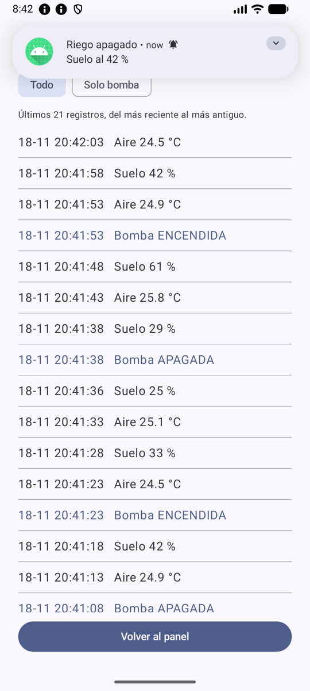](docs/capturas/p12-almacenamiento.png) |
| P13 | Persistencia | Cerrar la app del todo (`force-stop`), abrirla y entrar | El historial sigue ahí | ✔ Siguen los eventos de las 20:41 y 20:42, anteriores al cierre | [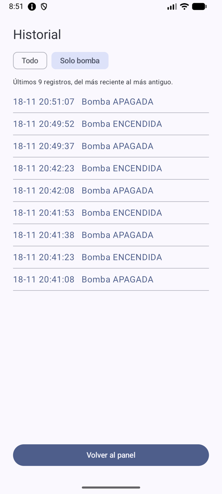](docs/capturas/p13-persistencia.png) |
| P14 | Credenciales protegidas | Copiar la base con `adb` y revisar la tabla `usuarios` con `sqlite3` | Solo la sal y el hash (BLOB) | ✔ Sal BLOB de 16 bytes y hash BLOB de 32 bytes; la contraseña no aparece en el archivo | [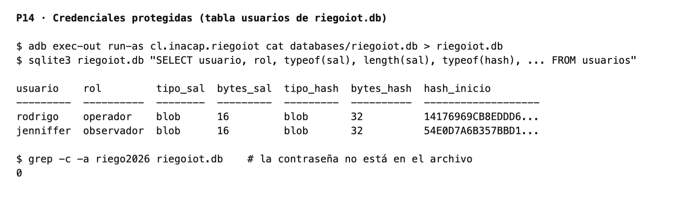](docs/capturas/p14-credenciales.png) |

P8 también tiene la captura de la observadora: [p08b-observador.png](docs/capturas/p08b-observador.png). P9, la del primer error: [p09a-login-incorrecto.png](docs/capturas/p09a-login-incorrecto.png).

**Prueba extra: repetición de un comando grabado.** El mismo `CMD;bomba;ON` cifrado de P4, publicado otra vez más de 30 s después, **se rechaza**: «Comandos rechazados: 1» y la bomba sigue APAGADA ([captura](docs/capturas/p-extra-repeticion.png)).

### Pruebas unitarias

```bash
JAVA_HOME="/Applications/Android Studio.app/Contents/jbr/Contents/Home" ./gradlew testDebugUnitTest
```

Las 13 pruebas unitarias cubren el formato y los rangos de los mensajes, los tópicos, PBKDF2, el bloqueo del login y el cifrado AES-GCM: ida y vuelta, otro código, otro tópico, mensaje alterado, texto sin cifrar y compatibilidad con `cifrar.ts`. El detalle de cada sesión de pruebas está en la bitácora de [ProyectRiego/docs/EVA2_AVANCE.md](https://github.com/rodrigocutinoa/ProyectRiego/blob/main/docs/EVA2_AVANCE.md).

## Estado

| Hito | Estado |
|---|---|
| 0 | Proyecto Android (minSdk 26, Kotlin DSL) corriendo en el emulador |
| 1 y 2 | Definición y diseño: [docs/HITOS_1_2.md](docs/HITOS_1_2.md) |
| 3 | Conexión MQTT, roles Nodo y Panel, comandos y notificaciones |
| 5 | Login con SQLite, PBKDF2 y roles |
| 6 | Historial en SQLite |
| 4 | Cifrado AES-GCM de los mensajes con código de vinculación |
| 7 | Medidas ISO/IEC 27400 y OT, y pruebas P1–P14 con capturas: 14 de 14 pasan |
| 8 | Pendiente: demostración |

## Herramientas

Android Studio · Kotlin · Jetpack Compose y Material 3 · corrutinas · Eclipse Paho MQTT 1.2.5 · SQLite · `javax.crypto` (PBKDF2 y AES-GCM) · hertzbench (MCP) · emulador Android 17 arm64.
