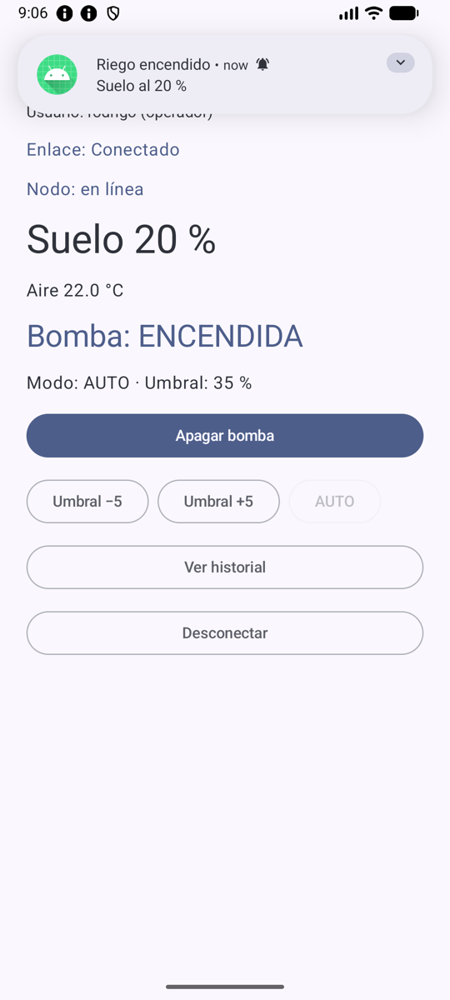
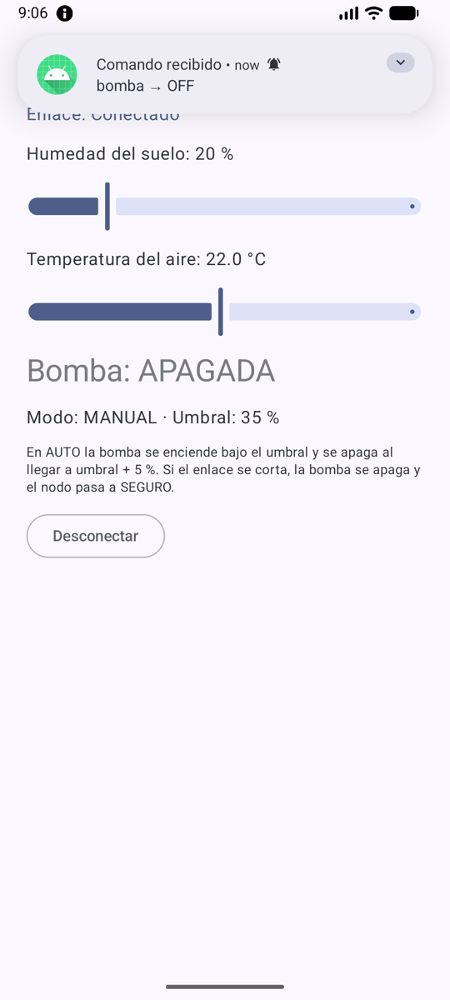
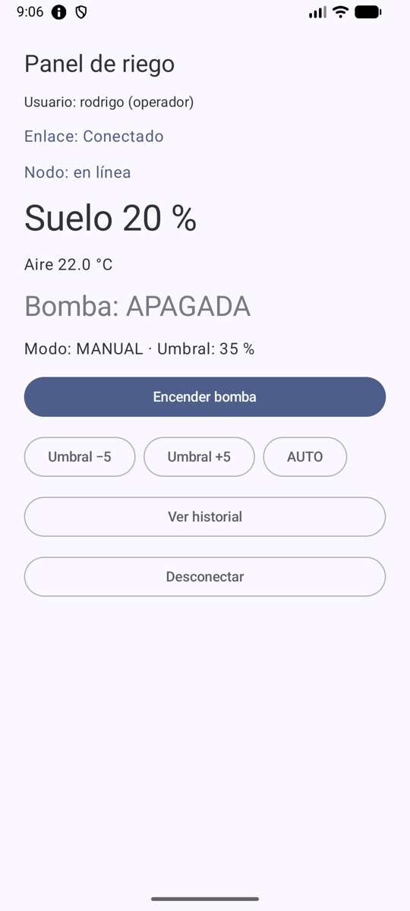

# Guion de la demostración (Hito 8)

**RiegoIoT-App** · Jenniffer Gonzalez y Rodrigo Cutiño · 5 a 7 minutos

Sigue los cinco pasos de la guía (sección 8.1), adaptados a nuestro proyecto: el sensor es la humedad del suelo, el actuador es la bomba, el medio es Wi-Fi con MQTT y los dos "teléfonos" son dos emuladores Android conectados al broker simulado en hertzbench. El guion se ensayó completo el 2026-11-18.

| Pantalla | Emulador | Cuenta | Rol en la app |
|---|---|---|---|
| Izquierda | `emulator-5554` (Medium Phone) | `rodrigo` (operador) y `jenniffer` (observadora) | **Panel** |
| Derecha | `emulator-5556` (Nodo_Riego) | `nodo1` | **Nodo de riego** |

Broker `10.0.2.2:1883` · código de vinculación **`123456`** · escenario `ProyectRiego/hertzbench/riego-broker.yaml`.

---

## Antes de la clase (10 minutos)

1. **Liberar memoria:** cerrar Android Studio, Chrome y otras apps pesadas. Dos emuladores ocupan unos 6 GB.
2. **Encender los dos "teléfonos"** e instalar la última versión:
   ```bash
   cd ~/Dev/Inacap/AppIoT/RiegoIoT-App
   scripts/demo-emuladores.sh
   ```
3. **Abrir Claude Code en la app** (`code ~/Dev/Inacap/AppIoT/RiegoIoT-App`), revisar con `/mcp` que `hertzbench` esté conectado y pedirle:
   > *Corre ../ProyectRiego/hertzbench/riego-broker.yaml y abre la vista en vivo.*

   Abrir en el navegador la URL que devuelve `open_view`. Es el mapa del canal Wi-Fi, para mostrarlo en el paso 2.
4. **Dejar el Nodo listo** (derecha): ingresar con `nodo1`, elegir **Nodo de riego**, código `123456`, **Conectar**. Debe decir «Enlace: Conectado» y «Modo: AUTO».
5. **Dejar el Panel en el login** (izquierda), con la sesión cerrada.
6. Ventanas a la vista: los dos emuladores lado a lado, VS Code con Claude Code y el navegador con la vista de hertzbench.

> Dato práctico: en el emulador, PBKDF2 tarda entre 10 y 15 s en el login y al conectar. Ese tiempo se aprovecha para explicar.

---

## La demostración

### 1. Autenticación (1 min)

| Hacer (Panel) | Decir |
|---|---|
| Ingresar `rodrigo` con una contraseña **equivocada** → «Usuario o contraseña incorrectos» | «La contraseña nunca se guarda. En SQLite guardamos una sal aleatoria de 16 bytes y un hash PBKDF2-SHA256 con 120 000 iteraciones. Calcularlo es lento a propósito, para frenar la fuerza bruta.» |
| Ingresar con la contraseña **correcta** → «Usuario: rodrigo (operador)» | «Tras 5 intentos fallidos, el login se bloquea 30 segundos. El primer usuario registrado es operador y los siguientes son observadores.» |

### 2. Conexión (1 min)

| Hacer | Decir |
|---|---|
| Panel: rol **Panel**, código `123456`, **Conectar** → «Enlace: Conectado», «Nodo: en línea», valores del nodo | «Elegimos Wi-Fi con MQTT y no Bluetooth: el huerto está a más de 10 metros, el nodo tiene corriente porque mueve una bomba, y el ESP32 de la Unidad 1 ya habla MQTT. Ninguno de los equipos necesita la IP del otro: los dos hablan con el broker por tópicos.» |
| Mostrar la vista de hertzbench en el navegador | «El broker y el canal Wi-Fi los simula hertzbench, el simulador que nos dio el profesor. Lo controlamos desde Claude Code por MCP.» |

### 3. Monitoreo y control (1 min 30 s)

| Hacer | Decir |
|---|---|
| Nodo: mover el deslizador de humedad a **20 %** | «El nodo está en AUTO. Bajo el umbral de 35 % enciende la bomba, y la apaga al llegar a umbral + 5 %, igual que en la Unidad 1.» |
| Panel: llega **«Riego encendido · Suelo al 20 %»** y se ve «Bomba: ENCENDIDA» | «Este es el requisito mínimo: cada vez que el riego se enciende o se apaga, llega una notificación con el estado.» |
| Panel: **Apagar bomba** → Nodo: **«Comando recibido · bomba → OFF»**, modo MANUAL; Panel: confirma en menos de 2 s | «Cada comando espera la confirmación ACK del nodo. Si no llega en 5 s, el panel lo reenvía hasta 3 veces y, si sigue sin llegar, avisa "Sin respuesta del nodo".» |

### 4. Datos (1 min)

| Hacer | Decir |
|---|---|
| Panel: **Ver historial**, luego el filtro **Solo bomba** | «Cada lectura y cada encendido o apagado queda en SQLite con su hora, y sigue ahí al cerrar la app.» |
| Mostrar la tabla `usuarios`: la captura [p14-credenciales.png](capturas/p14-credenciales.png), o en vivo con Database Inspector si Android Studio está abierto | «En la tabla de usuarios solo se ve la sal y el hash como BLOB. La contraseña no está en ninguna parte del archivo.» |

### 5. Seguridad (1 min 30 s)

| Hacer | Decir |
|---|---|
| Panel: **Volver al panel**. Pedir a Claude Code: *«corta el enlace del teléfono con inject_fault al 100 %»*. Esperar unos 10 s | «Simulamos que se cae el Wi-Fi.» |
| Nodo: «Reconectando…», **Bomba: APAGADA**, **Modo: SEGURO**, aviso «Enlace perdido». Pedir: *«restablece el enlace»* | «Estado seguro, como pide la industria OT: si el nodo pierde el enlace, apaga la bomba solo, sin esperar ninguna orden.» |
| Panel: **Desconectar** y reconectar con el código **`111111`** → «Mensajes rechazados: N», «Nodo: sin datos» | «Cada mensaje va cifrado con AES-GCM, con una clave derivada del código de vinculación. Con otro código no se lee nada y los mensajes se descartan. Tampoco sirve repetir un comando grabado: los de más de 30 s se rechazan.» |
| Panel: **Desconectar**, **Cerrar sesión** e ingresar con `jenniffer` → conectar con `123456` → botones deshabilitados | «La observadora ve los datos, pero no controla. El permiso se revisa en la pantalla y también en el código que envía los comandos.» |

### Cierre (30 s)

> «Los límites que declaramos: el código de 6 dígitos con sal fija sirve para la demostración, pero en producción usaríamos un intercambio de claves como ECDH o el Android Keystore. Y como el broker es simulado, en la Unidad 4 el nodo será el ESP32 real de la Unidad 1, que ya habla el mismo MQTT.»

---

## Si algo falla (plan B)

| Problema | Qué hacer |
|---|---|
| Dos emuladores dejan lento el Mac | Usar **un solo emulador como Panel** con `riego-mqtt.yaml`, que trae un nodo simulado con el código `123456`. Los comandos al nodo se muestran con `mqtt_publish` y `deno run ../ProyectRiego/hertzbench/cifrar.ts 123456 riego/cmd "CMD;bomba;ON"` |
| «Error: no se pudo conectar (SocketTimeoutException…)» | Revisar que el escenario esté corriendo (`get_status`) y que la app tenga el permiso de red local (Ajustes → Apps → RiegoIoT → Permisos) |
| «Conectado» pero «Nodo: sin datos» | El código es distinto en el Nodo y en el Panel |
| No aparece la notificación | Permiso de notificaciones negado: Ajustes → Apps → RiegoIoT → Notificaciones |
| El emulador muestra «System UI isn't responding» | Tocar **Wait**; pasa recién encendido |
| Se olvidó una contraseña de prueba | Desinstalar y reinstalar la app (`adb uninstall cl.inacap.riegoiot` y `scripts/demo-emuladores.sh`) y crear las cuentas de nuevo |

## Quién hace qué (sugerencia)

- **Una persona maneja** los emuladores y Claude Code.
- **La otra explica** cada paso con la columna «Decir».

Conviene ensayarlo una vez juntos, cronometrando.

## Capturas del ensayo

| Dos teléfonos conectados | Riego encendido (Panel) | Comando recibido (Nodo) | Confirmado (Panel) |
|:-:|:-:|:-:|:-:|
|  |  |  |  |
